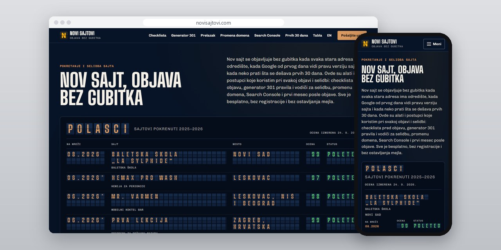
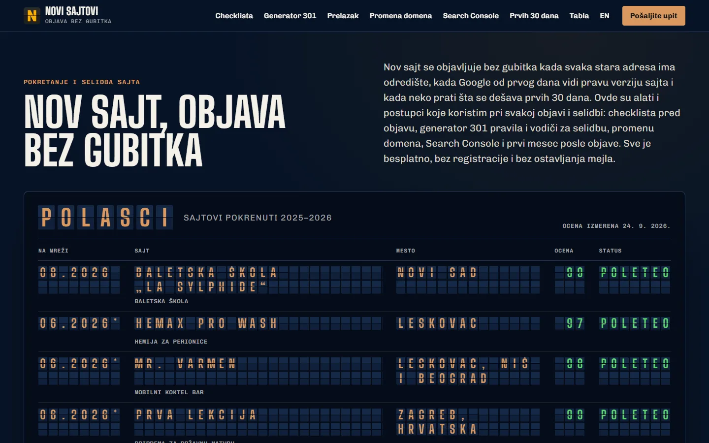
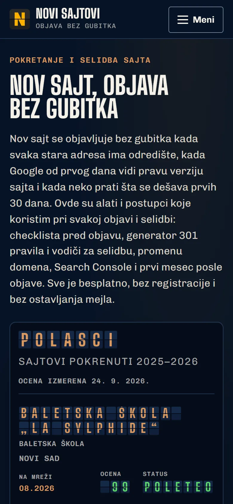
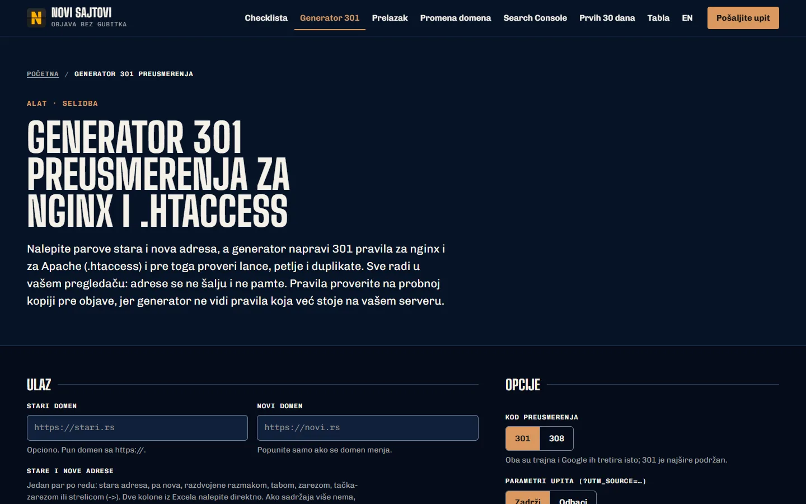

# Novi sajtovi

Postupci koje pratim kad se sajt objavljuje ili seli, sa checklistom pred objavu i generatorom 301 preusmerenja.

**[novisajtovi.com](https://novisajtovi.com/)** · [Studija slučaja](https://svilenkovic.rs/radovi/novi-sajtovi) · [English](README.md)

> [!NOTE]
> Moj sopstveni projekat, ne klijentski posao. Izvorni kod je privatan. Ova stranica opisuje šta sajt radi i kako je napravljen.

<table>
  <tr><td><b>Klijent</b></td><td>Sopstveni projekat</td></tr>
  <tr><td><b>Delatnost</b></td><td>Objava i selidba sajtova</td></tr>
  <tr><td><b>Lokacija</b></td><td>Srbija</td></tr>
  <tr><td><b>Vrsta</b></td><td>Sajt sa više strana i alatima</td></tr>
  <tr><td><b>Moj deo posla</b></td><td>Istraživanje, dizajn, izrada, SEO i hosting</td></tr>
  <tr><td><b>Tehnologije</b></td><td>Astro 7, TypeScript, PHP 8.3, SQLite, nginx</td></tr>
</table>

## O projektu

Nov sajt najviše izgubi na dan objave: stare adrese ostanu bez odredišta, Google vidi pogrešnu verziju, a prve nedelje niko ne gleda šta se dešava. Na novisajtovi.com sam skupio alate i postupke koje koristim pri svakoj objavi i selidbi. Vodiči idu redom kojim radim i sam: spisak starih adresa, jedna promena u jednom trenutku, pa praćenje posle objave.

Početna strana izgleda kao tabla polazaka na aerodromu, a na njoj su sajtovi koje sam pokrenuo 2025. i 2026: delatnost, mesto, vrsta sajta, mobilna ocena i mesec od kada su na mreži. Pločice sam napravio sam, bez biblioteke za animaciju. Tekst u HTML-u se ne menja dok se pločice prelistavaju, pa ga pretraživač i čitač ekrana čitaju normalno, a uz smanjeno kretanje tabla odmah stoji u krajnjem stanju.

## Šta sam uradio

- Checklista pred objavu sa 52 provere u osam grupa, štiklira se u pregledaču i ništa se ne šalje
- Generator 301 pravila za nginx i Apache koji prvo pronađe lance, petlje i duplikate
- Česti propusti iz mojih studija slučaja, kao IPv6 zapis koji vodi na server koji se ne javlja
- Ručno pravljene split-flap pločice koje ne diraju tekst u HTML-u
- Vodiči za prelazak na nov sajt, promenu domena, Search Console i prvih 30 dana posle objave

## Merenja

| | Performanse | Pristupačnost | Dobre prakse | SEO |
| :-- | :-: | :-: | :-: | :-: |
| Telefon | 100 | 100 | 100 | 100 |
| Desktop | 100 | 100 | 100 | 100 |

PageSpeed Insights, laboratorijsko merenje živog sajta, oktobar 2026. Sigurnosna zaglavlja: 6 od 6. axe provera pristupačnosti: bez prekršaja. Strukturisani podaci: `FAQPage`, `Person`.

## Snimci ekrana

<table>
  <tr>
    <td width="68%" valign="top"></td>
    <td width="32%" valign="top"></td>
  </tr>
</table>

Generator 301 pravila posle provere lanaca, petlji i duplikata

---

Izrada: [D. Svilenković](https://svilenkovic.rs).
